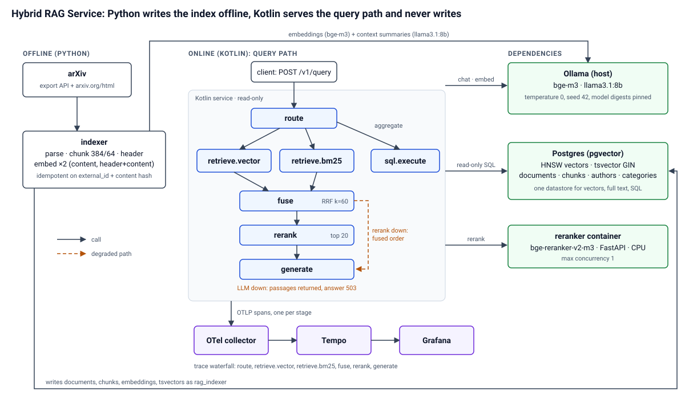

# Hybrid RAG Service

Hybrid RAG service over 92 arXiv full-text papers (cs.IR, cs.CL, cs.DB, 2023–2026; the ingest was cut short of the planned 200): metadata-filtered BM25 + vector retrieval on Postgres/pgvector, cross-encoder reranking and SQL/vector routing — Kotlin serving layer, Python eval harness.

## Results

| # | Config | nDCG@10 | Recall@20 | p95 latency (ms) | Cost/query |
|---|---|---|---|---|---|
| 1 | `01-vector` | 0.665 | 0.888 | 260 | n/a |
| 2 | `02-hybrid` | 0.582 | 0.886 | 413 | n/a |
| 3 | `03-filters` | 0.589 | 0.906 | 320 | n/a |
| 4 | `04-contextual` | 0.611 | 0.895 | 307 | n/a |
| 5 | `05-rerank` | 0.846 | 0.895 | 8,446 | n/a |
| 6 | `06-routing` | 0.791 | 0.840 | 9,303 | 0.0000 |

Time-boxed run: all six rows are retrieval-only (generation off) on all 150 questions, so nDCG@10 and Recall@20 (scored on the 127 questions that have gold chunks) and p95 latency exclude generation and are comparable across rows; cost per query is not reported for them. Generation and the LLM judge ran only for row 6 (`06-routing`) on the 50-question CI subset, where cost is 0.0000 because both models run locally and `pricing.yaml` prices them at zero. Every number is produced by the eval runner and traceable to a run file: full table in [`evals/results.md`](evals/results.md), dataset in [`evals/dataset/DATASET_CARD.md`](evals/dataset/DATASET_CARD.md). A cell that reads "not measured (time-boxed run)" was not run.

## Architecture



## Findings

- Metadata filtering changed nDCG@10 from 0.582 to 0.589 for 320 ms p95.
- Cross-encoder reranking changed nDCG@10 from 0.611 to 0.846 for 8,446 ms p95.
- Adding BM25 hybrid fusion changed nDCG@10 from 0.665 to 0.582 for 413 ms p95 (vector-only: 260 ms). That is a regression: Recall@20 stayed flat (0.888 to 0.886), so the lexical leg added no recall and pushed nDCG@10 down. Pre-filter and post-filter pushdown also tied on Recall@20 on this small corpus ([`evals/results_filter_pushdown.md`](evals/results_filter_pushdown.md)).

## Run it

Prerequisites: Docker, [Ollama](https://ollama.com) running on the host, [uv](https://docs.astral.sh/uv/), JDK 21+ (`make doctor` checks them).

```bash
cp .env.example .env
make models        # pulls bge-m3 and llama3.1:8b into host Ollama
make reranker      # separate terminal: cross-encoder on the host (Apple GPU via MPS); first start downloads ~2.2 GB
make up            # docker compose up: Postgres, migrations, service, tracing
make index         # ingests up to 200 papers (the published results use the 92 that were indexed): fetch, parse, chunk, embed
make query Q="How can symbolic knowledge be integrated into neural networks?"
```

The reranker runs on the host because Docker Desktop cannot reach the Apple GPU, and on CPU it took about 40 s per 20 passages. On Linux, `make up-reranker-container` runs it as a CPU container on the same port. Step-by-step setup, troubleshooting and the branch layout are in [docs/GUIDE.md](docs/GUIDE.md).

## Latency budget

Timeouts are the hard per-stage limits in the service; a stage that exceeds one degrades the response instead of failing it. p50/p95 are the `06-routing` figures in `evals/results.md`; the `generate` and `total` rows exist only where generation ran (50-question subset), and are marked not measured otherwise.

| Stage | Timeout (budget) | p50 | p95 |
|---|---|---|---|
| `route` | 5 000 ms | 988 | 1,459 |
| `embed` | 2 000 ms | 164 | 248 |
| `retrieve.vector` | 1 500 ms | 56 | 151 |
| `retrieve.bm25` | 1 500 ms | 91 | 452 |
| `filter.estimate` | 500 ms | 3 | 13 |
| `fuse` | none (in-process) | 0 | 0 |
| `rerank` | 10 000 ms | 6,198 | 7,184 |
| `sql.generate` (aggregate route only) | 15 000 ms | 5,475 | 7,383 |
| `sql.execute` (aggregate route only) | 2 000 ms | 10 | 17 |
| `generate` | 45 000 ms | not measured (time-boxed run) | not measured (time-boxed run) |
| `total` | none (sum of the stages that ran) | 7,491 | 9,285 |

## Decisions

- [ADR 0001: Postgres + pgvector over Elasticsearch or a dedicated vector database](docs/adr/0001-postgres-pgvector-over-elasticsearch.md)
- [ADR 0002: HNSW over IVFFlat, with build-time and recall numbers](docs/adr/0002-hnsw-over-ivfflat.md)
- [ADR 0003: Kotlin serving layer, Python offline: why the seam sits there](docs/adr/0003-kotlin-serving-python-offline.md)
- [ADR 0004: Self-hosted cross-encoder over a managed rerank API](docs/adr/0004-self-hosted-cross-encoder.md)
- [ADR 0005: Contextual chunking strategy and the chunk size chosen](docs/adr/0005-contextual-chunking-and-chunk-size.md)
- [ADR 0006: Pre-filter vs over-fetch-and-post-filter policy](docs/adr/0006-filter-pushdown-policy.md)
- [ADR 0007: Why no agent loop](docs/adr/0007-no-agent-loop.md)

HNSW index build time on this corpus: 10.924 s (m = 16, ef_construction = 64), against 0.832 s for IVFFlat. HNSW is slower to build and needs no training step.

## Trace

Each request emits one OpenTelemetry span per stage (`route`, `retrieve.vector`, `retrieve.bm25`, `fuse`, `rerank`, `generate`) to the local collector, Tempo and Grafana.


*Screenshot pending: capture it as described in [`docs/img/README.md`](docs/img/README.md).*

## Evaluation

The dataset has 150 questions (60 factoid, 37 multi-chunk, 30 filter-dependent, 15 aggregate, 8 unanswerable) in [`evals/dataset/questions.v1.jsonl`](evals/dataset/questions.v1.jsonl); see the [dataset card](evals/dataset/DATASET_CARD.md). Candidates were generated by an LLM from sampled chunks and verified by an agent against the source text. **Human review is pending**: no question has been verified by a person. Retrieval metrics (nDCG@10, recall@k, MRR) were measured on the 127 questions that have gold chunks, and routing accuracy and latency on all 150, for all six configs with generation off; they do not depend on the judge. Generation, faithfulness and answer relevance were measured only for `06-routing` on the 50-question CI subset, because the full grid with generation and judging takes hours. Those two are scored by `llama3.1:8b`, the same model family that generated the answers and many candidates, so treat them as noisy and not comparable across rows; the other five rows have no faithfulness or answer-relevance score.

Load test (k6, local only, retrieval-only scenario): the 20 rps target is not sustainable on this machine. p95 was 3058 ms against a 500 ms threshold, with 26 % of requests failing and nearly all successful ones degraded to lexical-only results, because the host-Ollama embedding call (about 125 ms, one request at a time) and the database pool saturate. Numbers, caveats and the 5 rps run are in [`load/README.md`](load/README.md).

## CI eval gate

CI cannot run the real models (hosted runners have no GPU and no Ollama), so the gate replays recorded ones. It restores the real index from a database snapshot published as a GitHub Release, serves recorded Ollama and reranker responses from WireMock, and runs the six configs on a 50-question subset with exact vector search, comparing against committed thresholds. That catches regressions in this repository's code (retrieval SQL, fusion, filter pushdown, routing parse, SQL guard, rerank merge) but not model drift, and it does not measure generation quality, which stays a local `make eval` result. When a change alters what the service sends to a model, a request has no recording, the gate fails with exit code 2, and the fix is `make eval-record-ci` locally and committing the new cassettes and thresholds.

## Non-goals

- No knowledge graph: Neo4j adds an operational dependency for a payoff this corpus cannot demonstrate.
- No multimodal retrieval: expensive to evaluate honestly, shallow to implement.
- No agent loop: unbounded retrieval without evals is a demo (see [ADR 0007](docs/adr/0007-no-agent-loop.md)).
- No fine-tuning and no custom embedding training.
- No UI beyond `make query` and the Grafana trace view.
- Single tenant, single corpus, English only.

## Deferred on purpose

- Multi-tenancy: add a tenant id to `documents` and push it into every filter and into row-level security, then re-run the filter-pushdown benchmark per tenant.
- Incremental re-embedding on a model upgrade: store the model digest per chunk, re-embed in the background into a second embedding column and cut over when recall on the eval set matches.
- Streaming responses: stream the generation stage over server-sent events and keep the retrieval stages synchronous, with the degraded flags in the first event.
- Query caching: cache fused candidate lists keyed by the normalised question and filters, and invalidate by index fingerprint.
- Conversational multi-turn rewriting: rewrite the follow-up into a standalone question with the LLM before routing, and evaluate it on a separate multi-turn set.

## Repo layout

```
service/     Kotlin + Spring Boot: the query path (routing, retrieval, rerank client, generation)
indexer/     Python: arXiv fetch, parsing, chunking, embedding, index benchmark
evals/       Python: dataset, runner, configs, results.md, CI cassettes and thresholds
reranker/    Python FastAPI: bge-reranker-v2-m3 cross-encoder
infra/       docker-compose, Flyway migrations, OTel collector, Tempo, Grafana
load/        k6 load test
docs/        architecture.svg, ADRs, GUIDE.md, trace screenshot
```
