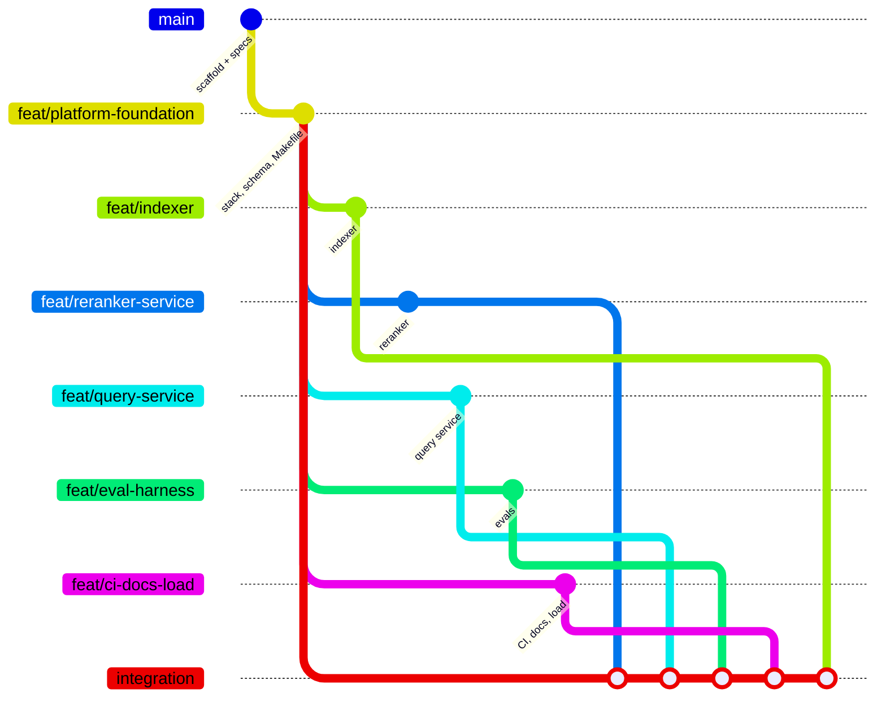

# Developer guide

How to set up the stack, run each part, and find your way around the branches. The [README](../README.md) is the 60-second overview. Each package's own README covers its internals:

- [indexer](../indexer/README.md)
- [reranker](../reranker/README.md)
- [service](../service/README.md)
- [evals](../evals/README.md)
- [load](../load/README.md)

## 1. Prerequisites

| Tool | Why | Check |
|---|---|---|
| Docker Desktop (≥ 8 GB memory) | Postgres, the query service, tracing, WireMock | `docker info` |
| [Ollama](https://ollama.com) on the host | `bge-m3` embeddings and `llama3.1:8b` generation | `curl localhost:11434/api/tags` |
| [uv](https://docs.astral.sh/uv/) | indexer, reranker and evals (Python 3.12) | `uv --version` |
| JDK 21+ (the build uses a JDK 25 toolchain with Java 21 bytecode) | the Kotlin service | `java -version` |
| `jq`, `curl` | `make query` | — |
| k6 (optional, runs in Docker by default) | load test | — |

`make doctor` checks all of these and prints what is missing.

## 2. First run

```bash
cp .env.example .env          # passwords and ports; .env is git-ignored
make doctor
make models                   # ollama pull bge-m3 && ollama pull llama3.1:8b
make reranker                 # terminal 2, stays in the foreground (see 2.1)
make up                       # Postgres + Flyway, query service, OTel collector, Tempo, Grafana
make index                    # 200 arXiv papers -> documents, chunks, embeddings
make query Q="Which reranking models are evaluated in the indexed cs.IR papers?"
```

| Endpoint | URL |
|---|---|
| Query API | `POST http://localhost:8080/v1/query`, `GET /v1/info` |
| Reranker | `POST http://localhost:8081/rerank`, `GET /healthz` |
| Postgres | `localhost:5433`, database `rag`; roles `rag_owner`, `rag_indexer`, `rag_reader`, `rag_router` |
| Grafana (traces through Tempo) | http://localhost:3000 |

### 2.1 Where the reranker runs

The cross-encoder (`BAAI/bge-reranker-v2-m3`) runs as a host process by default. Docker Desktop on macOS cannot reach the Apple GPU. On CPU in Docker, one 20-passage request took about 40 s, against a 10 s rerank timeout. On the host with MPS it takes a few seconds. `RERANKER_DEVICE=auto` picks `mps`, then `cuda`, then `cpu`. `/healthz` reports the device it chose and turns `ready` only after a warm-up batch.

On Linux or in CI, use `make up-reranker-container` instead. It publishes the same port 8081, so the service finds either one at `http://host.docker.internal:8081`.

### 2.2 How long things take (M4, 24 GB)

| Step | Time |
|---|---|
| `indexer select --target 220` (arXiv, 3 s politeness delay) | ~24 min, once; cached under `data/cache/` |
| `make index` (200 papers, embeddings + one context-header LLM call per paper) | 1–4 h depending on machine load |
| Full eval grid `make eval` (150 questions × 6 configs, with judge) | hours; run it overnight |

## 3. Day-to-day commands

| Task | Command |
|---|---|
| Stop / start the stack (keeps data) | `make down` / `make up` |
| Wipe everything, including the index | `make clean` |
| Start only infra (no service image) | `make up-infra` |
| Lint and test every package | `make lint`, `make test` |
| One package | `cd indexer && uv run pytest` · `cd service && ./gradlew test` |
| Ablation grid → `evals/results.md` | `make eval` |
| CI gate locally (offline replay) | `make eval-ci SNAPSHOT=data/snapshots/<file>.dump` |
| Re-record CI cassettes after changing a prompt or request | `make eval-record-ci` (needs the reranker running) |
| Load test, one scenario | `SCENARIO=retrieval make load` |
| Snapshot / restore the index | `make snapshot`, `make snapshot-restore SNAPSHOT=<file>` |

Ingest is idempotent. Re-running `make index` skips papers whose content hash has not changed, so an interrupted run resumes where it stopped.

## 4. Branches and how the code was built

The build follows [OpenSpec](https://github.com/Fission-AI/OpenSpec) spec-driven development. Each capability is one change under `openspec/changes/` (proposal, spec deltas, design, tasks), and each change is implemented on its own branch.

| Branch | OpenSpec change | Owns |
|---|---|---|
| `feat/platform-foundation` | `add-platform-foundation` | `infra/`, `Makefile`, `.env.example`, contracts C1–C11 |
| `feat/indexer` | `add-indexer` | `indexer/` |
| `feat/reranker-service` | `add-reranker-service` | `reranker/` |
| `feat/query-service` | `add-query-service` | `service/` |
| `feat/eval-harness` | `add-eval-harness` | `evals/` |
| `feat/ci-docs-load` | `add-ci-docs-load` | `.github/`, `load/`, `docs/`, `README.md` |
| `integration` | — | all of the above merged; this is what runs end to end |



The rules each branch followed:

- **Contracts first.** `openspec/changes/add-platform-foundation/design.md` holds every cross-package contract: the DB schema, env vars and ports, the Ollama and reranker APIs, the query API, the eval config and the dataset record. The other designs copy those blocks verbatim. A change to a contract is made on the foundation branch and merged into the feature branches.
- **One owner per directory.** A feature branch touches only its own directory and its change's `tasks.md`, so the merges into `integration` do not conflict.
- **Tasks are ticked only when verified.** Every `- [x]` in a `tasks.md` names the command that proved it.

To see what is left: `openspec list` (task counts per change), or `grep -n '\- \[ \]' openspec/changes/*/tasks.md`.

## 5. Troubleshooting

| Symptom | Cause and fix |
|---|---|
| Rerank calls time out; responses carry `degraded: ["rerank_unavailable"]` | Reranker not running, or running on CPU. Start `make reranker` and check that `curl localhost:8081/healthz` shows `"device":"mps"` and `"ready":true`. |
| `make index` fails with connection refused on 11434 | Ollama is not running: `ollama serve`. |
| Selection or fetch gets HTTP 500 from arXiv | Was a query-encoding bug (`+TO+` sent as `%2B`), fixed in the indexer. Re-run; the cache keeps finished pages. |
| Testcontainers cannot find Docker (Docker 29) | The service pins Testcontainers 1.21.4+, which negotiates the API version. Run `./gradlew --stop` if an old daemon still holds the previous version. |
| `uv run ruff` says "Failed to spawn" | Dev tools are missing from the venv. Run `uv sync` in the package (dev tools are in the default `dev` group). |
| `make eval-ci` exits 2 | A request had no recorded cassette. Run `make eval-record-ci`, then commit `evals/cassettes/ci/` and `evals/thresholds/ci.yaml`. |
| `make eval-ci` exits 3 | Setup problem: missing snapshot, cassettes, or model digests that differ from `infra/models.lock.json`. |
